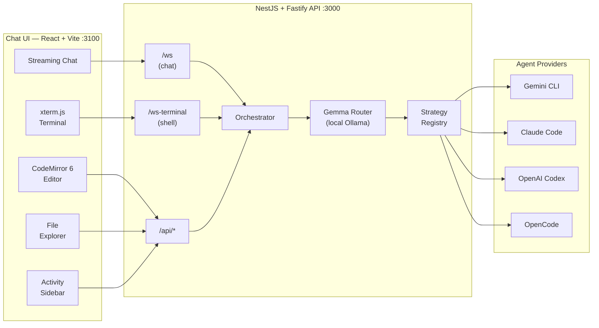

<p align="center">
  
</p>

<h1 align="center">Fibe Agent</h1>

<p align="center">
  <strong>A coding agent with streaming chat, an inline editor, a terminal, and multiple providers.</strong>
</p>

<p align="center">
  
  
  <a href="https://bun.sh"></a>
  <a href="https://nx.dev"></a>
  
</p>

<p align="center">
  
  
  
  
  
  
</p>

---

**Fibe Agent** combines a **NestJS + Fastify** API with a **React + Vite** client. It runs Gemini, Antigravity, Claude Code, OpenAI Codex, Cursor, OpenCode, or a mock provider over a streaming WebSocket. The client includes chat, a **CodeMirror 6 editor**, an **xterm.js terminal**, activity history, file editing, voice input, attachments, `@` file references, OAuth, Light/Dark themes, and iframe support.


## Features at a glance

| Area | Details |
| --- | --- |
| **Agent providers** | `gemini`, `antigravity`, `claude-code`, `openai-codex`, `cursor`, `opencode`, or `mock`, selected with `AGENT_PROVIDER`. Supports OAuth and API tokens. |
| **Streaming chat** | WebSocket at `/ws` with per-chunk streaming, reasoning/thinking steps, tool-call and file-created events, token usage, and agent interrupt. |
| **Code editor** | CodeMirror 6 with highlighting for 15+ languages, unsaved-change indicators, shortcuts, and REST-backed saves. |
| **Interactive terminal** | xterm.js terminal backed by `node-pty` over `/ws-terminal`, spawning shells in the playground directory. |
| **Activity sidebar** | Agent reasoning, tool calls, file operations, and status in chronological order. |
| **File explorer** | Real-time playground file tree; open, edit, view, and save files without leaving the chat. |
| **Voice input** | Records with `MediaRecorder` and sends the audio as an attachment. |
| **Gemma MCP Router** | Optional local Ollama model (`gemma3:4b`) that classifies intent and suggests MCP tools. |
| **File attachments** | Images, audio, PDF, Office, CSV, JSON, or text files up to 20 MB each. |
| **`@`-mention files** | Type `@` to reference playground files; the API injects their contents into the prompt. |
| **Conversation persistence** | Messages, activity, model and effort choices, uploads, and provider sessions by conversation id. |
| **Fibe integration** | `FibeSyncService`, `postMessage` auto-auth, and iframe embedding with parent-controlled theming. |
| **Security** | Helmet (CSP, frame-ancestors), rate limiting (100 req/min), shared-password bearer auth, multipart validation. |
| **Structured logging** | One JSON object per line with request IDs and HTTP/WebSocket context; `LOG_LEVEL`. |
| **Testing** | Co-located unit specs with 100% coverage, plus Playwright tests for the API and Chat. |
| **Docker** | Multi-arch (`linux/amd64`, `linux/arm64`) GHCR images per provider. |

## Architecture



## Quick start

Requires [Bun](https://bun.sh); the version is pinned in `package.json`.

```sh
bun install
bun run dev                                      # API http://localhost:3000 (/api/health), Chat http://localhost:3100
AGENT_PROVIDER=mock bunx nx serve api            # no provider CLI or key needed
API_URL=http://localhost:3000 bunx nx serve chat # Chat against an API on another host
```

Chat's Vite server proxies `/api` and `/ws` to the API. For password protection set `agentPassword` in `fibe.yml` or `FIBE_SETTINGS_JSON`; `AGENT_PASSWORD` alone does not enable authentication.

Fibe containers receive one built-in local stdio MCP entry through `MCP_CONFIG_JSON` (`fibe mcp serve --yolo` with `FIBE_API_KEY` and `FIBE_DOMAIN`), which keeps the bundled CLI and MCP tools aligned without a daemon. Expose Fibe only once per environment to avoid duplicate tools.

## Documentation

| Document | Contents |
| --- | --- |
| [AGENTS.md](AGENTS.md) | Providers, settings and environment, authentication, persistence, local MCP tools, images, scripts, module map |
| [docs/API.md](docs/API.md) | REST, WebSocket, structured output, delivery identities and logging contract |
| [MULTI.md](MULTI.md) | Multi-conversation runtime and per-provider session behaviour |
| [contracts/mobile-client.md](contracts/mobile-client.md) | Mobile client request, response and event contract |
| [docs/providers/runtime-contracts.md](docs/providers/runtime-contracts.md) | Provider CLI/SDK runtime contracts |
| [docs/runtime-tools.md](docs/runtime-tools.md) | Tool and provider CLI pins, image smoke checks |
| [prompts/README.md](prompts/README.md) | System prompt reference library |

## Project layout

```
apps/api/       NestJS + Fastify: /ws, /ws-terminal, REST /api/*
apps/chat/      React + Vite: chat, editor, terminal, sidebar, explorer
apps/e2e-api/   Playwright e2e for the API
apps/e2e-chat/  Playwright e2e for Chat
shared/         Shared TS types, WS constants, API path helpers
playground/     Agent working directory (file explorer root)
data/           Persisted messages, activities, uploads per conversation
```

## Lockfiles

`bun.lock` serves Bun, CI and Docker; `package-lock.json` keeps npm compatibility. Keep `bun.lock` when running `bun install`; CI uses `bun install --frozen-lockfile`.

## Embedding (iframe)

- **Auto-auth:** the parent posts `{ action: 'auto_auth', password: '…' }`; Chat signs in.
- **Theme control:** the parent posts `{ action: 'set_theme', theme: 'light'|'dark' }` (requires `VITE_THEME_SOURCE=frame`); `winter` and `halloween` are normalized to `light` and `dark`.

## Light and Dark appearance

The interface uses a neutral monochrome palette, Plus Jakarta Sans, solid surfaces and standard controls. Editor and terminal chrome follow the theme; syntax, ANSI and status colors keep their meaning. Tony Stark mode keeps its separate interface. Waiting messages use ordinary status text regardless of prompt keywords.

The `chat-theme` storage key and `fibe_theme_changed` event are unchanged. Canonical themes are `light` and `dark`; `winter` migrates to `light`, and `halloween`, `dracula`, `midnight` and `contrast` migrate to `dark`. Startup follows the system preference without saving an inferred choice.

## License

MIT. See `package.json`.
